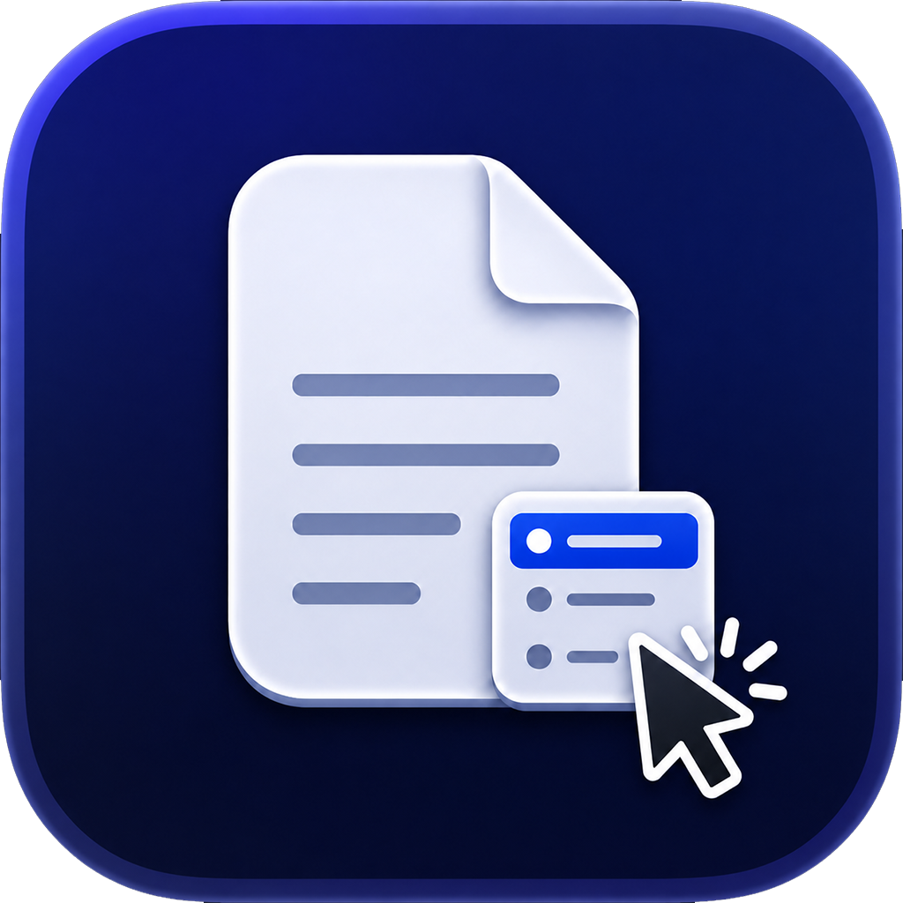
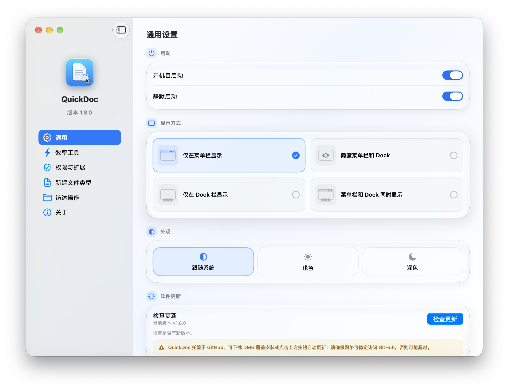
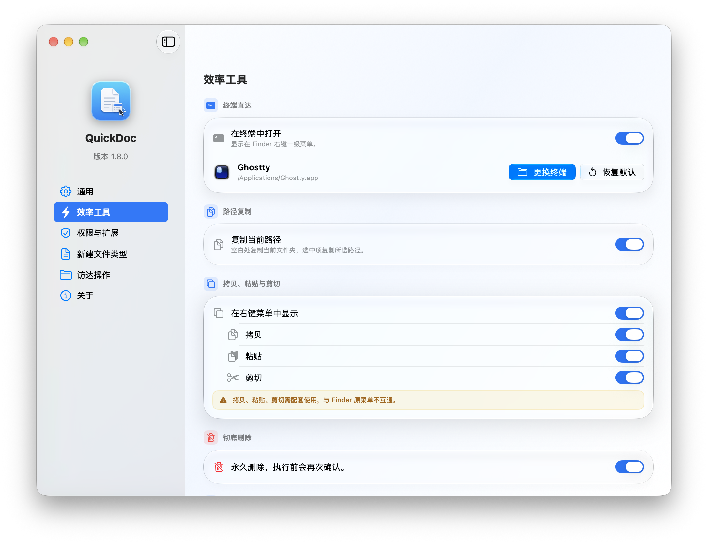
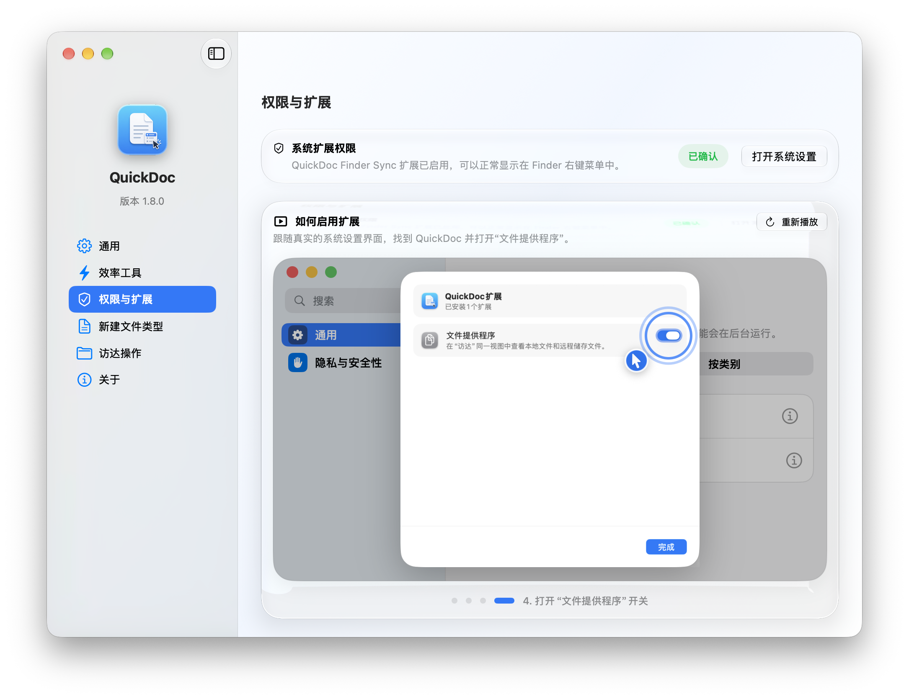
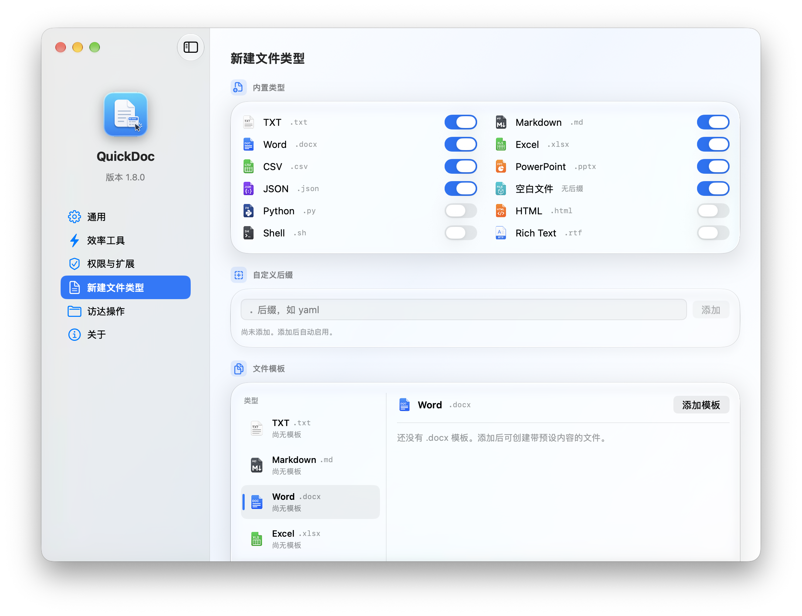
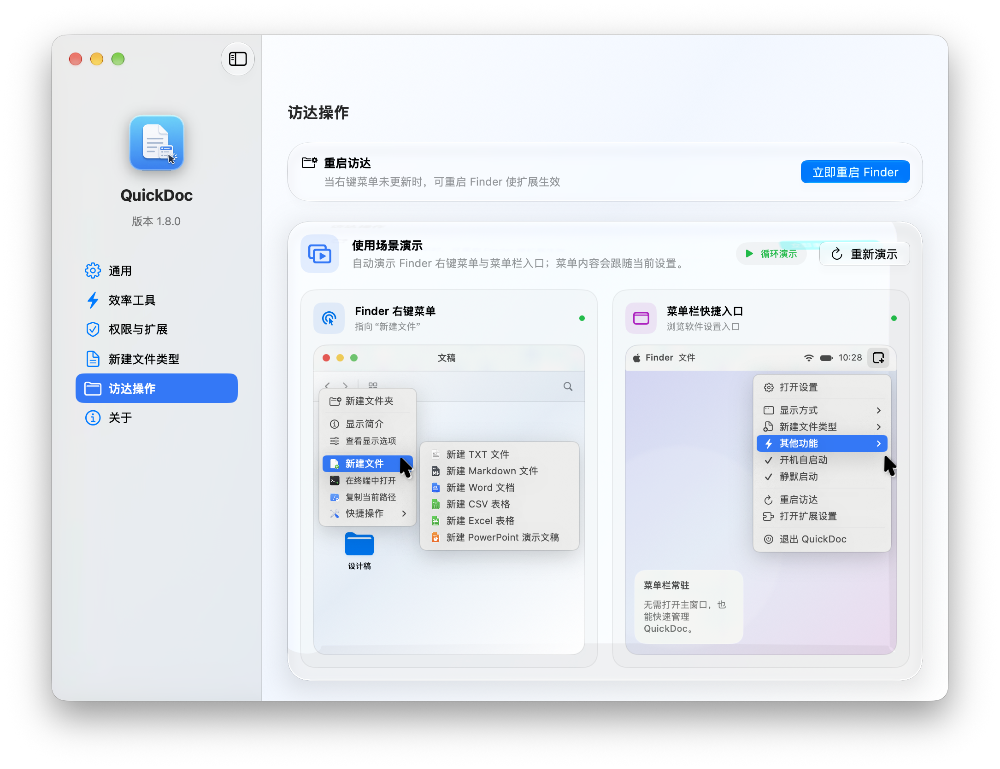
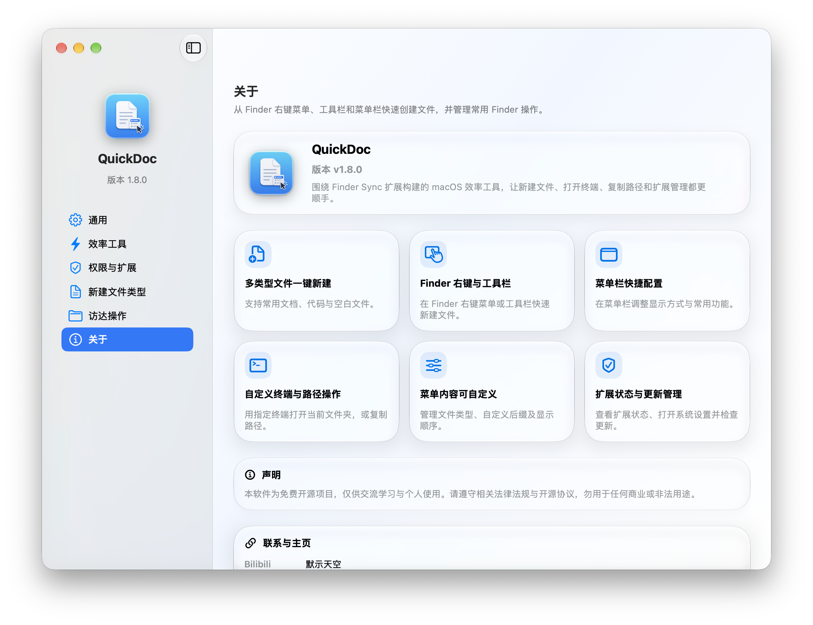

<div align="center">
  
  <h1>QuickDoc</h1>
  <p>Finder の右クリックメニューとツールバーから一般的なファイルを直接作成できます。</p>
  <p>
    <a href="https://github.com/SkyImplied/QuickDoc/releases/tag/v1.8.0"></a>
    
    
    <a href="https://github.com/SkyImplied/QuickDoc/releases/download/v1.8.0/QuickDoc-1.8.0.dmg"></a>
    <a href="https://github.com/SkyImplied/QuickDoc/releases"></a>
  </p>
  <p>
    <a href="README.md">English</a> | <a href="README.zh-CN.md">简体中文</a> | <a href="README.zh-TW.md">繁體中文</a> | 日本語
  </p>
</div>

## 画面

<p align="center">
  <br>
  <strong>一般</strong>
</p>

<p align="center">
  <br>
  <strong>効率ツール</strong>
</p>

<p align="center">
  <br>
  <strong>権限と拡張機能</strong>
</p>

<p align="center">
  <br>
  <strong>新規ファイル形式</strong>
</p>

<p align="center">
  <br>
  <strong>Finder 操作</strong>
</p>

<p align="center">
  <br>
  <strong>情報</strong>
</p>

QuickDoc は macOS の Finder Sync 拡張機能を活用したユーティリティです。Finder のコンテキストメニューに実用的な「新建文件」サブメニューを追加します。v1.3 以降では Finder のツールバーにも QuickDoc を追加でき、ツールバーから直接ファイルを作成できます。

## v1.8.0 の新機能

1. 設定ウィンドウの初期サイズを 960×720、最小サイズを 880×660 に縮小しました。
2. 設定画面を簡素化し、システム標準の折りたたみ可能なサイドバーと整理された各ページにしました。
3. 初期状態ではオフの実験的項目「外置硬盘右键菜单（实验性）」を追加しました。一般的な利用ではオンにしないことを推奨します。オンにすると外付けディスクのマウントポイントを監視し、Finder がそのディスクアイコンを QuickDoc のロゴで表示することがあります。オフに戻しても、Finder がそのディスクを読み直すまでアイコンが残ることがあります。アイコンの変化を避けたい場合はオフのまま、QuickDoc を Finder ツールバーに追加して使ってください。
4. このスイッチが右クリックメニューを追加するのは、`/Volumes/名前` に直接マウントされ、ローカルでブラウズ可能、DiskArbitration が内蔵ではないと報告し、プロトコルが USB、Thunderbolt、PCI Express、SD、FireWire、SATA、SAS、SCSI、ATAPI のいずれかであるボリュームだけです。ディスクイメージ、ネットワークボリューム、シミュレータのボリュームは対象外です。すべての外付けディスクやファイルシステムで使えることを保証するものではありません。

## v1.7.7 の新機能

1. ツールバーのメニューを組み立てる際に Finder へ同期 AppleEvent を送っていたため、メニューが「待機中…」のまま止まる問題を修正しました。
2. 監視対象外のフォルダ（外付けボリュームを含む）でツールバーから操作したとき、作成先がホームフォルダへ誤って戻る問題を修正しました。作成先を確定できない場合は操作を中止し、別の場所へ書き込みません。
3. メインアプリに Finder 自動化の entitlement を追加し、macOS が通常の手順で QuickDoc に Finder の制御許可を求められるようにしました。照会に失敗した場合は AppleEvent の数値エラーを記録します。

## v1.7.6 の新機能

1. 外付けハードディスクや USB ドライブなどをマウントした際に、システムのディスクアイコンが QuickDoc のアイコンとして誤表示される問題を修正しました。外付けボリュームでは Finder ツールバーからのみ QuickDoc を利用でき、右クリックメニューは追加されません。
2. 外付けドライブのファイルシステムが macOS の書き込みに対応していない場合、または読み取り専用でマウントされている場合に、明確な書き込みエラーを表示するようにしました。

## v1.7.5 の新機能

### バグ修正

- 重大な安全上の問題を修正しました。何も選択していない状態で Finder の空白部分からコピー、カット、または完全削除を実行しても、現在のフォルダやその中の全ファイルを誤操作しなくなりました。
- ファイルまたはフォルダを選択した後、コピー、カット、完全削除が反応しない問題を修正しました。
- 完全削除の実行後に QuickDoc のアイコンが Dock に表示される問題を修正しました。
- 操作対象と選択状況の検証を強化し、空白部分から危険なファイル操作が誤って実行されることを防止しました。

### アプリの改善とビジュアル刷新

- カード、アイコン、余白、操作スタイルを統一し、画面全体のデザインを刷新しました。
- サイドバーを再整理し、「効率ツール」などの機能を独立したカテゴリにまとめました。
- 一般設定、効率ツール、新規ファイル形式、カスタムテンプレート、メニュープレビューを再設計しました。
- Finder の右クリックメニューとメニューバー操作を紹介するアニメーションデモを追加しました。
- コピー、ペースト、カットの配置を改善し、Finder 標準のクリップボード操作とは連携しないことを明示しました。
- ターミナル選択、パスのコピー、表示方法、ソフトウェア更新の説明を改善しました。
- 情報の見やすさ、操作の安全性、全体的な使いやすさを向上しました。

## v1.7.1 の新機能

- 「権限と拡張機能」のデモカードがダークモードに対応しました。

## v1.7.0 の新機能

- ライト、ダーク、システム設定に従う外観モードを追加しました。
- 拡張機能の権限設定を分かりやすく案内するデモカードを追加しました。

## v1.6.5 の新機能

- コピー、ペースト、カットを個別に表示または非表示にできるようになりました。
- コピー、ペースト、カットのアイコンを統一されたスタイルに更新しました。
- ファイルやフォルダを完全に削除する機能を追加し、実行前にリスクを示す確認画面を表示します。
- コピー、ペースト、カット、完全削除を「快捷操作」にまとめるか、Finder の第1階層メニューに個別表示できます。

## v1.6.4 の新機能

- クイック操作を展開表示または折りたたみ表示から選べるようになりました。
- 展開表示では、コピー、ペースト、カットが Finder の右クリック第1階層メニューに直接表示されます。
- 折りたたみ表示では従来どおり、3つの操作が第1階層の「快捷操作」メニュー内にまとめられます。

## v1.6.3 の新機能

- 一般設定の表示方式オプションで、カード全体をクリックして切り替えられるようにしました。

## v1.6.1 の新機能

- `Open in Terminal` の使用時に、まれに QuickDoc 本体ウィンドウが開き Dock アイコンが表示される問題を修正しました。
- 一部のユーザー環境でアプリのロゴサイズが異常に表示される問題を修正しました。

## v1.6.0 の新機能

- クラウドドライブおよび外付けドライブの Finder で、ツールバーから QuickDoc を呼び出したときにコピーとカットが動作しない問題を修正しました。
- 外付けドライブの Finder で右クリックメニューから QuickDoc を呼び出せるようになりました。旧バージョンではツールバー経由のみ対応していました。クラウドドライブは Apple の制限により、現時点では右クリックからの直接呼び出しには対応していません。引き続きツールバーをご利用ください。
- DMG インストール画面を改善しました。

## v1.5.5 の新機能

- `复制当前路径` は Finder の現在の選択状態に追従するようになりました。何も選択していない場合は現在のフォルダのパスを、ファイルまたはフォルダを選択している場合は選択項目のフルパスをコピーします。
- 一般設定でターミナル起動とパスコピーを別々のセクションに分離し、ターミナル選択とパスコピーの挙動を確認しやすくしました。
- パスコピーの説明を見直し、有効化する前にフォルダパスと選択項目パスの違いが分かるようにしました。

## v1.5.4 の新機能

- 有効になっているファイル形式に対して、ユーザー独自のファイルテンプレートを追加できるようになりました。
- テンプレート管理画面を追加し、ファイル形式ごとに表示名、表示/非表示、並び順、名前変更、削除を管理できます。
- Finder の `新建文件` メニューは、表示対象のテンプレートがあるファイル形式では第 3 階層のテンプレートメニューを表示し、先頭に空白の既定ドキュメントを残します。
- カスタムファイル形式は `icons/空白.png` を共通アイコンとして使用し、テンプレート管理画面には有効なファイル形式だけを表示します。

## v1.5.2 の新機能

- いくつかの既知の不具合を修正
- アプリの使い勝手を改善し、「About」ページの機能概要と連絡先情報を更新
- DMG インストール手順を改善し、より分かりやすいドラッグ案内、大きなアイコン、中央揃えのレイアウト、Retina でも鮮明なインストール文言に更新

## v1.5.1 の新機能

- Finder の右クリックで新規作成した PowerPoint（`.pptx`）を開くと、PowerPoint が内容の問題を報告して修復を求める場合がある問題を修正
- 組み込みの空白 PPTX テンプレートを更新し、PowerPoint が必要とするマスター、レイアウト、テーマ、ドキュメントプロパティ、リレーション構造を含めました

## v1.5.0 の新機能

- 「在终端中打开」でサードパーティ製ターミナルアプリを選択できるようになりました
- 一般設定に選択中のターミナルアプリのアイコン、名前、パスを表示し、変更やシステム Terminal への復元を直接行えます
- 組み込みファイル形式アイコンのスタイルを統一し、全体の見た目を整えました

## v1.4.1 の新機能

- 一般設定の「ログイン時に起動」の下に「サイレント起動」オプションを追加
- 有効にすると、macOS ログイン時にメインウィンドウを表示せずバックグラウンドで起動

## v1.4.0 の新機能

- macOS のライトモードとダークモードに自動対応する専用テンプレートアイコンをメニューバーに追加
- メニューバーアイコンは左クリックと右クリックのどちらでもショートカットメニューを表示
- メインウィンドウを開かずにファイル形式やオプションの Finder アクションを設定できるメニューバーショートカットを追加
- サブメニュー内の切り替え操作後もメニューが閉じないため、複数の設定を続けて変更可能
- 新しいバージョンのダウンロード前に確認を求め、ZIP パッケージを検証し、終了後に旧バージョンを置き換えて再起動するアプリ内アップデート機能を追加

## v1.3.1 の新機能

- デスクトップにファイルを作成すると不要な Finder ウィンドウが開く場合がある問題を修正
- 「在终端中打开」でホームディレクトリのターミナルウィンドウが余分に開く場合がある問題を修正
- [#4](https://github.com/SkyImplied/QuickDoc/pull/4) で修正に貢献してくださった [DD-hit](https://github.com/DD-hit) さんに感謝します

## v1.3 の新機能

- Finder のツールバーに QuickDoc を追加して直接起動できるエントリを追加
- ローカルフォルダ、外付けドライブ、クラウドドライブなど、監視対象の Finder フォルダでツールバー機能を利用可能
- ユーザーフォルダ、一般的なディレクトリ、外部ボリューム、iCloud Drive まで監視範囲を拡張し、外付けドライブとクラウドドライブでの問題を修正
- 「一般」「権限と拡張機能」「新規ファイル形式」「Finder アクション」のページを備えた設定アプリを追加
- メニューバーのみ、メニューバーと Dock の両方を非表示、Dock のみ、メニューバーと Dock の両方を表示、という 4 種類の表示モードを追加
- ログイン時に起動、ターミナルで開く、現在のパスをコピーするための切り替え設定を追加
- Finder Sync 拡張機能の状態確認と、システム設定へのショートカットを追加
- Finder の右クリックメニューと同期するプレビューと並べ替え機能を追加
- 設定変更後に拡張機能をより確実に再読み込みできるよう Finder の再起動処理を改善

## QuickDoc を使う理由

- 別のアプリを開かずに Finder から一般的なファイルを直接作成
- 独自テンプレートからファイルを作成し、よく使う文書スタイルを毎回作り直す手間を減らせます
- 実際に使うファイル形式だけを表示
- 独自のワークフローに合わせてカスタム拡張子を追加
- 視覚的なプレビューでコンテキストメニューを整理
- 同じ右クリックメニューから現在のフォルダをターミナルで開く、またはパスをコピー
- 同名ファイルがある場合は番号付きの接尾辞を自動追加して上書きを防止

## 対応ファイル形式

v1.8.0 に組み込まれているファイル形式：

- TXT
- Markdown（`.md`）
- Word（`.docx`）
- Excel（`.xlsx`）
- CSV
- PowerPoint（`.pptx`）
- JSON
- 空のファイル
- Python（`.py`）
- HTML
- Shell（`.sh`）
- Rich Text（`.rtf`）

初期状態で有効な形式は `TXT`、`Markdown`、`Word`、`Excel`、`CSV`、`PowerPoint`、`JSON`、`空のファイル` です。

## 使用方法

1. `QuickDoc.app` を起動
2. 「权限与扩展」ページを開くか、`打开扩展设置` をクリック
3. macOS の Finder Extensions で `QuickDocFinderSync` を有効化
4. Finder のフォルダ背景、選択したフォルダ、またはデスクトップを右クリック
5. `新建文件` を選択し、必要なファイルを作成

設定で有効にすると、Finder のトップレベルのコンテキストメニューに `在终端中打开` と `复制当前路径` も表示されます。コピー、ペースト、カット、完全削除は個別に有効化でき、「快捷操作」にまとめるか、第1階層メニューへ展開できます。

## インストール

最も簡単な方法は GitHub Releases から最新の `QuickDoc-<version>.dmg` をダウンロードし、開いた後に `QuickDoc.app` を `Applications` にドラッグすることです。

続いて：

1. `QuickDoc.app` を開く
2. `权限与扩展` ページに移動するか、`打开扩展设置` をクリック
3. `システム設定 > プライバシーとセキュリティ > ログイン項目と機能拡張` で `QuickDocFinderSync` を有効化
4. メニューがすぐに表示されない場合は QuickDoc の `立即重启 Finder` を使用

v1.4.0 をインストールすると、以降のバージョンは一般設定ページ下部の `检查更新` から確認できます。新しいバージョンが見つかると QuickDoc はインストール前に確認を求め、同意後にダウンロードと置き換えを行います。完了すると自動的に再起動し、アップグレード完了を通知します。

macOS で開発元を確認できないという警告が表示された場合は、Finder で `Control` キーを押しながらアプリをクリックし、`開く` を選択してください。配布物は ad-hoc 署名です。Developer ID 署名や公証はありません。

## ソースからビルド

Finder Sync 拡張機能は Command Line Tools だけではビルドできないため、QuickDoc には完全版の Xcode が必要です。

### 方法 1：1 つのコマンドでローカルビルドして実行

```bash
sudo xcode-select -s /Applications/Xcode.app/Contents/Developer
./script/build_and_run.sh
```

このスクリプトは次の処理を行います：

1. `QuickDoc` アプリと Finder 拡張機能をビルド
2. Finder 拡張機能の登録を更新
3. Finder を再起動
4. `QuickDoc.app` を起動

初回起動後、macOS が拡張機能をまだ自動的に有効化していない場合は、`QuickDocFinderSync` を手動で有効にしてください。

### 方法 2：Xcode で手動ビルド

1. 必要に応じて一度実行：

```bash
sudo xcode-select -s /Applications/Xcode.app/Contents/Developer
```

2. Xcode で `QuickDoc.xcodeproj` を開く
3. `QuickDoc` スキームを選択
4. `Run` をクリック
5. Finder Extensions で `QuickDocFinderSync` を有効化

## リリース成果物をビルド

ソースから `.app`、`.zip`、`.dmg` をパッケージ化するには：

```bash
./script/package_release.sh
```

成果物は `build/release/` に生成されます。

## トラブルシューティング

設定変更や再ビルド後に Finder メニューが更新されない場合は、Finder を再起動してください：

```bash
killall Finder
```

メニューをクリックしても反応しない場合は、操作中にアプリと拡張機能のログを確認してください：

```bash
log stream --info --style compact --predicate 'process == "QuickDoc" OR process == "QuickDocFinderSync"'
```
