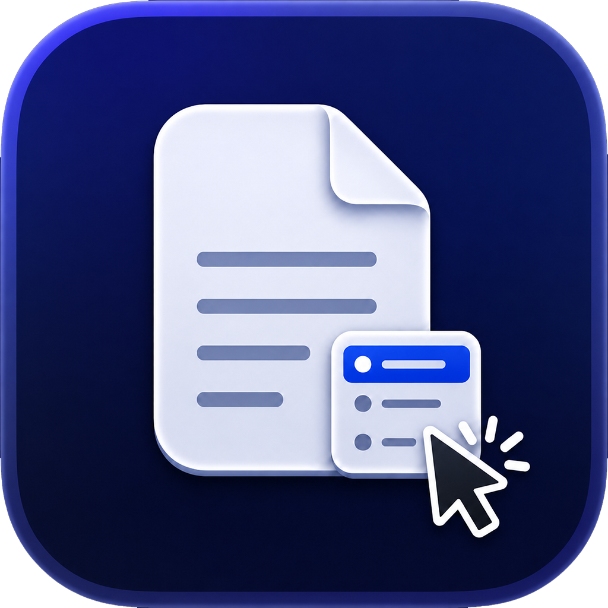
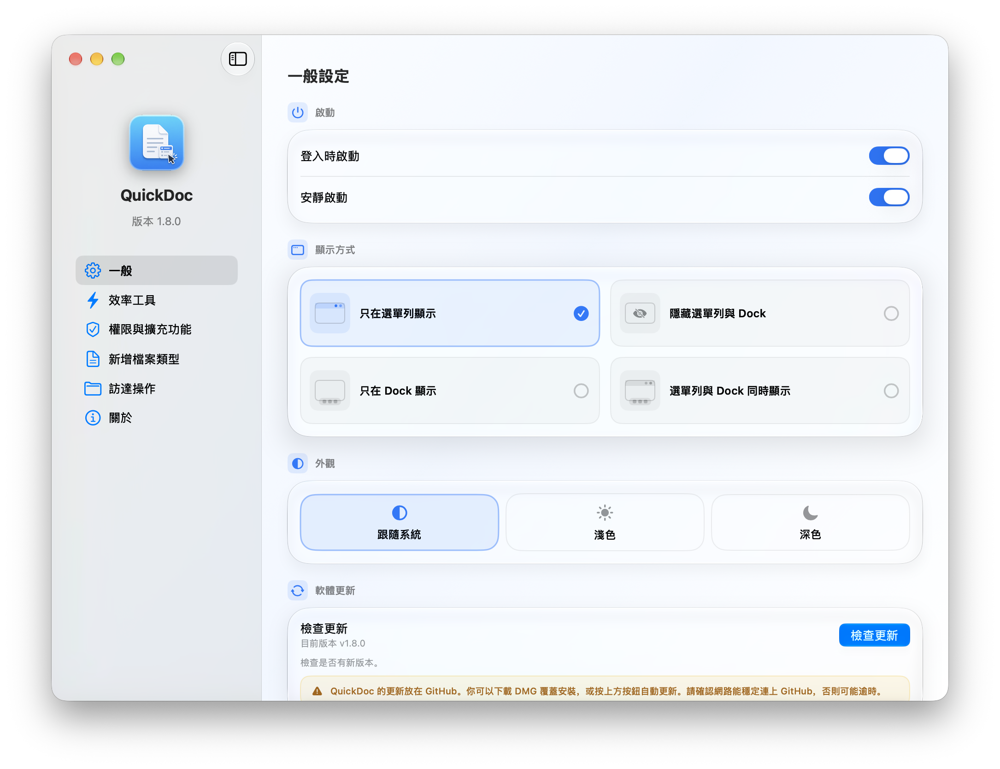
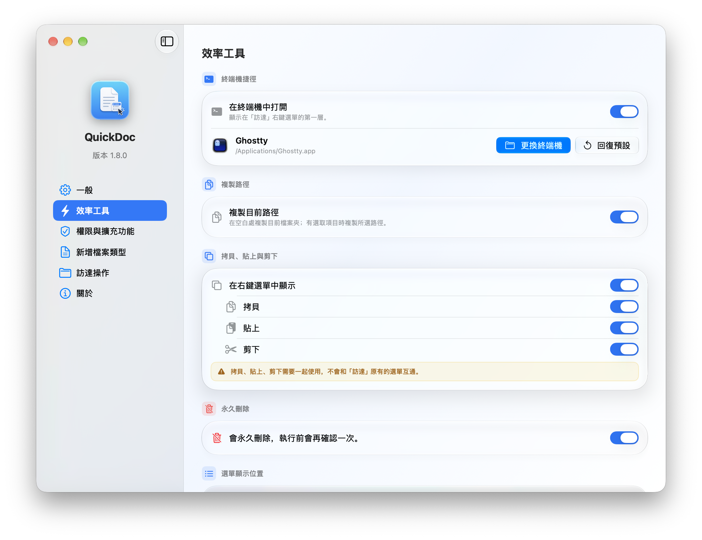
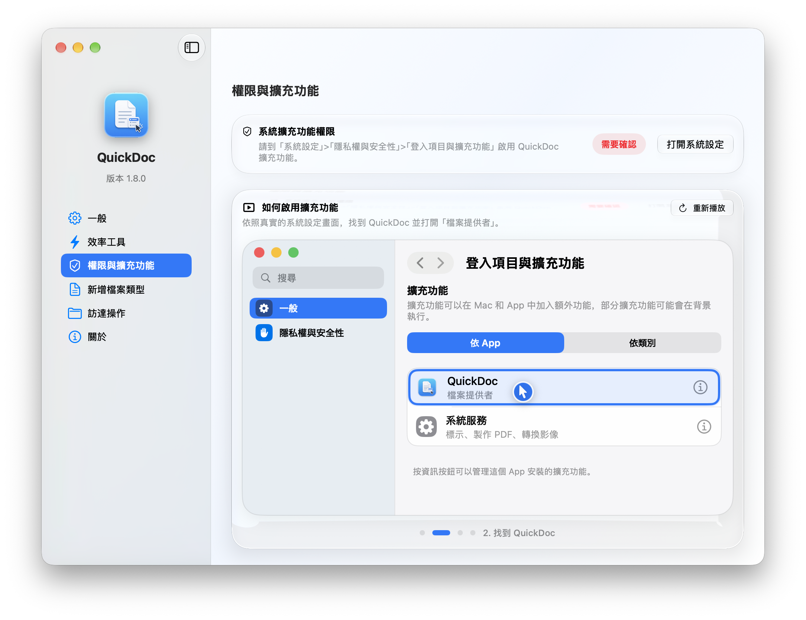
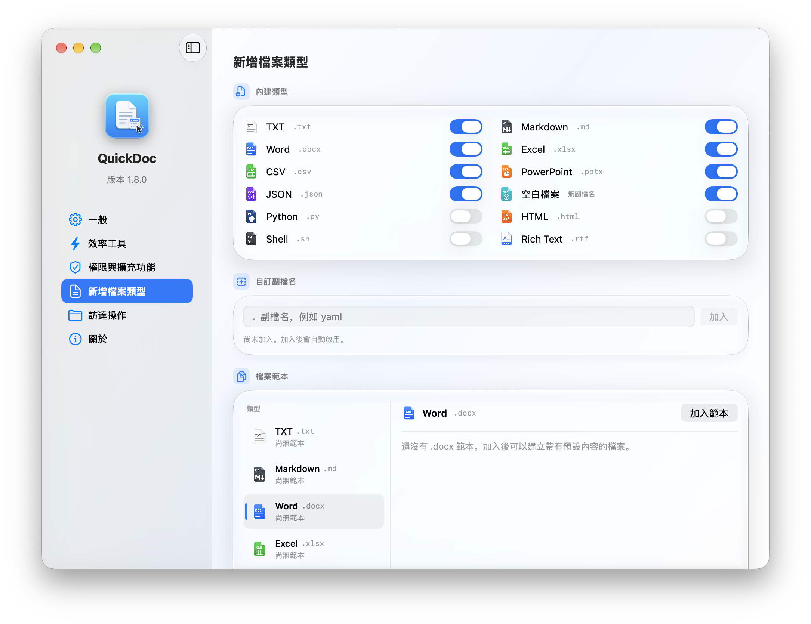
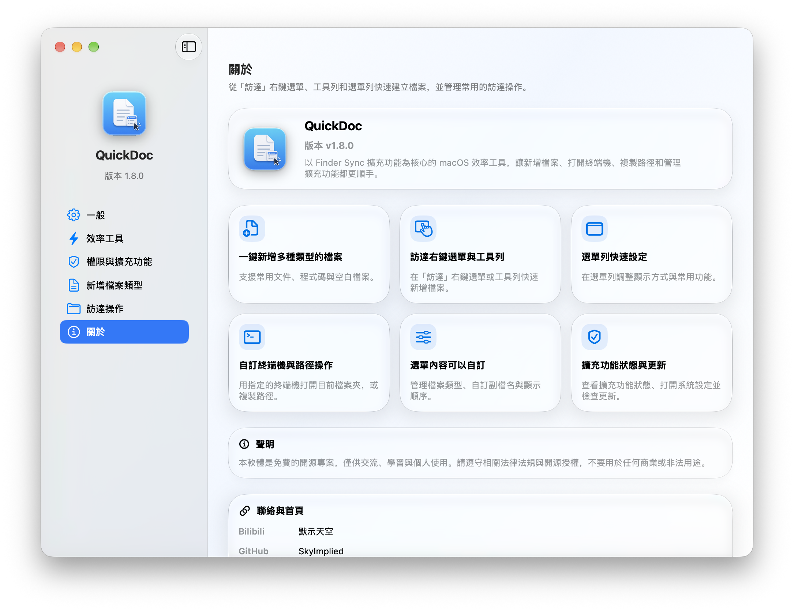

<div align="center">
  
  <h1>QuickDoc</h1>
  <p>直接從 Finder 右鍵選單和工具列建立常用檔案。</p>
  <p>
    <a href="https://github.com/SkyImplied/QuickDoc/releases/tag/v1.8.1"></a>
    
    
    <a href="https://github.com/SkyImplied/QuickDoc/releases/download/v1.8.1/QuickDoc-1.8.1.dmg"></a>
    <a href="https://github.com/SkyImplied/QuickDoc/releases"></a>
  </p>
  <p>
    <a href="README.md">English</a> | <a href="README.zh-CN.md">简体中文</a> | 繁體中文 | <a href="README.ja.md">日本語</a>
  </p>
</div>

## 介面

<p align="center">
  <br>
  <strong>通用</strong>
</p>

<p align="center">
  <br>
  <strong>效率工具</strong>
</p>

<p align="center">
  <br>
  <strong>權限與擴充功能</strong>
</p>

<p align="center">
  <br>
  <strong>新建檔案類型</strong>
</p>

<p align="center">
  <br>
  <strong>訪達操作</strong>
</p>

<p align="center">
  <br>
  <strong>關於</strong>
</p>

QuickDoc 是一款以 macOS Finder Sync 擴充功能為核心的效率工具。它會在 Finder 右鍵選單中加入實用的「新建文件」子選單；從 v1.3 開始，也支援將 QuickDoc 加入 Finder 工具列，直接從工具列建立新檔案。

## v1.8.1 更新亮點

1. 新增繁體中文、English 和日本語，並保留简体中文。
2. 預設跟隨 macOS 偏好的語言，也支援地區變體。可以在設定中選擇「跟隨系統」、简体中文、繁體中文、English 或 日本語。
3. 設定視窗和選單會立即使用所選語言。訪達擴充功能會在下次顯示選單時使用同一語言。

## v1.8.0 更新亮點

1. 預設設定視窗縮小為 960×720，最小尺寸為 880×660。
2. 設定介面做了簡約化重設計，使用原生可收合側邊欄，並整理了各個頁面。
3. 新增預設關閉的「外置硬盘右键菜单（实验性）」。不建議一般使用者開啟。開啟後會監聽外接磁碟掛載點，Finder 可能把磁碟圖示顯示為 QuickDoc Logo；關閉後，Finder 可能仍暫時保留已更換的圖示，直到重新讀取該磁碟。若在意圖示變化，請保持關閉，並建議將 QuickDoc 加入 Finder 工具列使用。
4. 此開關只為直接掛在 `/Volumes/名稱`、本機且可瀏覽、DiskArbitration 報告為非內建，並且協定是 USB、Thunderbolt、PCI Express、SD、FireWire、SATA、SAS、SCSI 或 ATAPI 的卷提供右鍵選單。磁碟映像、網路卷和模擬器卷不會加入。這不表示所有外接磁碟或檔案系統都可用。

## v1.7.7 更新亮點

1. 修正 Finder 工具列選單在組選單時同步向 Finder 傳送 AppleEvent，導致選單出現「正在等待…」並卡住的問題。
2. 修正未監視目錄（包括外接磁碟）上使用工具列時，目標可能錯誤落到使用者主目錄的問題。無法確定目標資料夾時會取消操作，不再靜默寫入其他目錄。
3. 為主應用程式補上 Finder 自動化 entitlement，使 macOS 可以依正常流程要求 QuickDoc 控制 Finder 的權限；查詢失敗時會記錄 AppleEvent 數字錯誤碼。

## v1.7.6 更新亮點

1. 修正掛載外接硬碟、USB 隨身碟等系統磁碟時，圖示錯誤顯示為 QuickDoc 圖示的問題；外接磁碟僅保留 Finder 工具列呼叫，不再加入右鍵選單。
2. 外接硬碟的磁碟格式不受 macOS 寫入支援，或宗卷以唯讀方式掛載時，新增明確的寫入提示。

## v1.7.5 更新亮點

### Bug 修復

- 修復重大安全風險：未選取任何項目時，在空白處執行剪下、拷貝或徹底刪除，不再誤操作目前目錄或目錄中的全部檔案。
- 修復選取檔案或資料夾後，拷貝、剪下與徹底刪除沒有反應的問題。
- 修復執行徹底刪除後，QuickDoc 圖示異常出現在 Dock 中的問題。
- 加強操作對象與選取情境驗證，避免在空白處誤觸高風險檔案操作。

### 應用升級與美化

- 全面升級介面視覺，統一卡片、圖示、間距與互動樣式。
- 重新整理側邊欄，將「效率工具」等功能獨立分類。
- 美化一般設定、效率工具、新建檔案類型、自訂範本及選單預覽頁面。
- 新增 Finder 右鍵選單與選單列動態操作演示。
- 優化拷貝、貼上、剪下版面，並增加與系統選單相互獨立的醒目提示。
- 優化終端機選擇、路徑拷貝、顯示方式及軟體更新說明。
- 提升整體資訊辨識度、操作安全性與使用體驗。

## v1.7.1 更新亮點

- 權限與擴充功能演示卡片支援深色模式。

## v1.7.0 更新亮點

- 新增深色、淺色與跟隨系統外觀模式切換。
- 新增擴充功能權限設定演示卡片，讓設定步驟更直觀。

## v1.6.5 更新亮點

- 支援分別顯示或隱藏拷貝、貼上與剪下。
- 統一更新拷貝、貼上與剪下的圖示風格。
- 新增「徹底刪除」檔案或資料夾功能，執行前會提示永久刪除風險並要求確認。
- 拷貝、貼上、剪下與徹底刪除可統一收納於「快捷操作」，或個別顯示在第一層選單。

## v1.6.4 更新亮點

- 快捷操作支援自訂展開或折疊。
- 選擇展開快捷操作時，拷貝、貼上和剪下會直接顯示在 Finder 右鍵第一層選單中。
- 選擇折疊快捷操作時，行為與舊版一致，拷貝、貼上和剪下會統一收納在「快捷操作」第一層選單內。

## v1.6.3 更新亮點

- 修復一般設定中顯示方式選項觸發區域的問題。

## v1.6.1 更新亮點

- 修復「在終端中打開」功能使用時，偶發錯誤打開軟體本體的問題。
- 修復部分使用者介面中軟體 Logo 顯示異常的問題。

## v1.6.0 更新亮點

- 修正在雲端硬碟、外接硬碟 Finder 中透過工具列呼叫 QuickDoc 時，拷貝和剪下功能失效的問題。
- 新增外接硬碟 Finder 右鍵選單快捷呼叫支援。舊版本只支援透過工具列呼叫；雲端硬碟受限於 Apple 政策，暫時不支援右鍵直接呼叫，仍請透過工具列呼叫。
- 美化透過 DMG 安裝時的安裝介面。

## v1.5.5 更新亮點

- 「复制当前路径」現在會依照 Finder 目前選取狀態決定內容：未選取檔案時複製目前資料夾路徑，選取檔案或資料夾時複製所選項目的完整路徑。
- 「一般設定」已將終端機捷徑與路徑複製拆成兩個獨立區塊，終端機選擇與路徑複製規則不再混在一起。
- 優化路徑複製說明，啟用前即可清楚理解「複製資料夾路徑」與「複製所選項目路徑」的差異。

## v1.5.4 更新亮點

- 新增自訂檔案範本功能，可為已啟用的檔案類型上傳自己的範本文檔，不再只能建立空白預設檔案。
- 新增依檔案類型分組的範本管理區，支援自訂右鍵選單顯示名稱、顯示/隱藏、排序、重新命名與刪除。
- Finder 右鍵的「新建文件」選單在某個檔案類型有可顯示範本時，會自動展開為第三層選單，並保留「空白預設文檔」作為第一個選項。
- 自訂檔案類型會統一使用 `icons/空白.png` 圖示；範本管理區只顯示已在上方新建檔案類型設定中啟用的類型。

## v1.5.2 更新亮點

- 修復一些已知問題
- 優化軟體使用體驗，更新「關於」頁面中的功能介紹與聯絡資訊
- 優化透過 DMG 安裝的軟體安裝流程，安裝視窗現在有更清楚的拖曳指引、更大的圖示、置中的內容版面與更清晰的 Retina 文案

## v1.5.1 更新亮點

- 修正透過 Finder 右鍵新建 PowerPoint（`.pptx`）後，PowerPoint 可能提示檔案內容有問題並要求修復的情況
- 更新內建空白 PPTX 範本，補齊 PowerPoint 需要的母版、版面配置、主題、文件屬性與關聯結構

## v1.5.0 更新亮點

- 「在终端中打开」新增第三方自訂終端機支援，可選擇自己常用的終端機 App
- 「一般」設定頁會顯示目前選定終端機的圖示、名稱與路徑，並提供更換或恢復系統終端機的操作
- 內建檔案類型 icons 完成統一化風格重構，整體視覺更一致

## v1.4.1 更新亮點

- 在「一般」設定頁的「登入時啟動」下新增「靜默啟動」開關
- 開啟後，登入 macOS 時 QuickDoc 會直接在背景執行，不再彈出主視窗

## v1.4.0 更新亮點

- 選單列圖示升級為專用範本圖示，可自動適應 macOS 淺色與深色模式
- 左鍵與右鍵點擊選單列圖示都會開啟快捷選單
- 選單列新增「新建文件类型」與「其他功能」快捷設定，不必開啟主視窗即可調整 Finder 右鍵選單
- 次層選單中的開關可連續勾選，調整多個項目時選單不會重複關閉
- 一般設定頁新增「检查更新」，發現新版本後會先詢問使用者，再下載 ZIP 安裝包、驗證並在結束程式後覆蓋舊版本，重新啟動後提示更新完成

## v1.3.1 更新亮點

- 修正在桌面建立檔案後可能額外開啟 Finder 視窗的問題
- 修正「在终端中打开」可能額外開啟一個使用者主目錄終端機視窗的問題
- 感謝 [DD-hit](https://github.com/DD-hit) 在 [#4](https://github.com/SkyImplied/QuickDoc/pull/4) 中貢獻以上修正

## v1.3 更新亮點

- 新增 Finder 工具列入口，可將 QuickDoc 加入 Finder 工具列並直接呼叫程式
- 工具列入口適用於本機 Finder、外接硬碟、雲端硬碟等所有已監控資料夾
- 擴充監控範圍涵蓋使用者主目錄、常用目錄、外接磁碟區與 iCloud Drive，解決外接硬碟和雲端硬碟無法使用的問題
- 新增完整設定應用程式，包含「一般」「權限與擴充功能」「新建檔案類型」「Finder 操作」等頁面
- 新增 4 種顯示方式：僅選單列、同時隱藏選單列與 Dock、僅 Dock、選單列與 Dock 同時顯示
- 新增登入時啟動、終端機捷徑、路徑複製開關
- 新增擴充功能狀態檢查，可在應用程式內確認 Finder Sync 是否啟用，並快速前往系統設定
- 新增右鍵選單預覽與排序編輯，設定順序後 Finder 選單會同步更新
- 改善 Finder 重新啟動流程，讓修改擴充功能設定後的重新整理更穩定

## 為什麼使用 QuickDoc

- 不必開啟其他應用程式，直接在 Finder 中以右鍵建立常用檔案
- 可從自己的範本建立檔案，常用文檔樣式不必每次從頭整理
- 只顯示實際需要的檔案類型，選單更簡潔
- 支援新增自訂副檔名，配合個人工作流程
- 透過視覺化預覽調整選單順序，減少尋找常用項目的時間
- 從同一個右鍵選單直接開啟終端機或複製目前路徑
- 自動避免檔名重複，若檔案已存在會加上數字後綴

## 支援的新建檔案類型

v1.8.0 內建支援：

- TXT
- Markdown（`.md`）
- Word（`.docx`）
- Excel（`.xlsx`）
- CSV
- PowerPoint（`.pptx`）
- JSON
- 空白檔案
- Python（`.py`）
- HTML
- Shell（`.sh`）
- Rich Text（`.rtf`）

預設啟用的類型為：`TXT`、`Markdown`、`Word`、`Excel`、`CSV`、`PowerPoint`、`JSON`、`空白檔案`。

## 使用方式

1. 啟動 `QuickDoc.app`
2. 開啟「权限与扩展」頁面，或點擊 `打开扩展设置`
3. 在 macOS Finder Extensions 中啟用 `QuickDocFinderSync`
4. 在 Finder 的資料夾空白處、選取的資料夾上，或桌面上點擊右鍵
5. 選擇 `新建文件`，建立需要的檔案

若在設定中啟用了相關開關，Finder 頂層右鍵選單還會出現 `在终端中打开` 與 `复制当前路径`。拷貝、貼上、剪下與徹底刪除可分別啟用或停用，並可統一收納於 `快捷操作`，或展開為第一層選單項目。

## 安裝方式

最簡單的方式是從 GitHub Releases 下載最新的 `QuickDoc-<version>.dmg`，開啟後將 `QuickDoc.app` 拖曳至 `Applications`。

接著：

1. 開啟 `QuickDoc.app`
2. 進入 `权限与扩展` 頁面，或點擊 `打开扩展设置`
3. 在 `系統設定 > 隱私權與安全性 > 登入項目與擴充功能` 中啟用 `QuickDocFinderSync`
4. 若右鍵選單沒有立即出現，可使用 QuickDoc 中的 `立即重启 Finder`

安裝 v1.4.0 後，後續版本可在「一般」頁面底部點擊 `检查更新`。發現新版本時，QuickDoc 會先詢問是否安裝；使用者確認後才會自動下載並安裝，完成覆蓋後重新開啟並提示升級成功。

若 macOS 提示應用程式來自未識別的開發者，可在 Finder 中按住 `Control` 點擊應用程式，再選擇 `打開`。發布包使用 ad-hoc 簽名，沒有 Developer ID，也沒有公證。

## 從原始碼建置

QuickDoc 依賴完整的 Xcode，因為 Finder Sync 擴充功能無法只靠 Command Line Tools 建置。

### 方式一：一鍵在本機建置並執行

```bash
sudo xcode-select -s /Applications/Xcode.app/Contents/Developer
./script/build_and_run.sh
```

這個指令碼會自動：

1. 建置 `QuickDoc` 主程式和 Finder 擴充功能
2. 重新整理 Finder 擴充功能註冊
3. 重新啟動 Finder
4. 啟動 `QuickDoc.app`

第一次執行後，若系統尚未自動啟用擴充功能，請手動開啟 `QuickDocFinderSync`。

### 方式二：使用 Xcode 手動建置

1. 如有需要，先執行一次：

```bash
sudo xcode-select -s /Applications/Xcode.app/Contents/Developer
```

2. 使用 Xcode 開啟 `QuickDoc.xcodeproj`
3. 選擇 `QuickDoc` scheme
4. 點擊 `Run`
5. 在 Finder Extensions 中啟用 `QuickDocFinderSync`

## 從原始碼產生發布檔案

若要自行產生 `.app`、`.zip` 或 `.dmg`：

```bash
./script/package_release.sh
```

產生的檔案會輸出至 `build/release/` 目錄。

## 疑難排解

若修改設定或重新建置後 Finder 選單沒有重新整理，可手動重新啟動 Finder：

```bash
killall Finder
```

若點擊選單後沒有反應，可在操作時查看應用程式與擴充功能記錄：

```bash
log stream --info --style compact --predicate 'process == "QuickDoc" OR process == "QuickDocFinderSync"'
```
